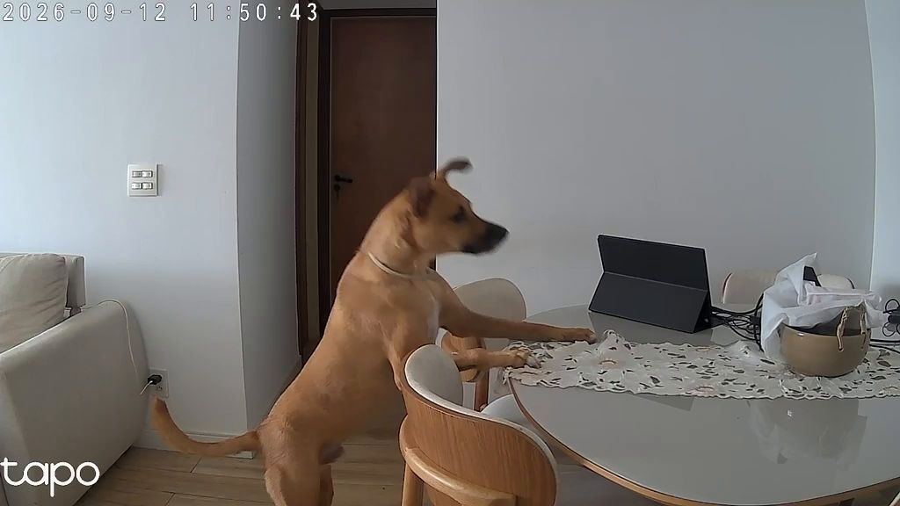
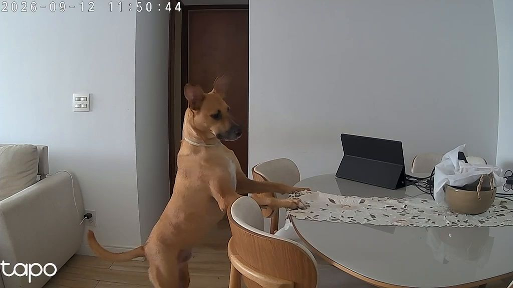
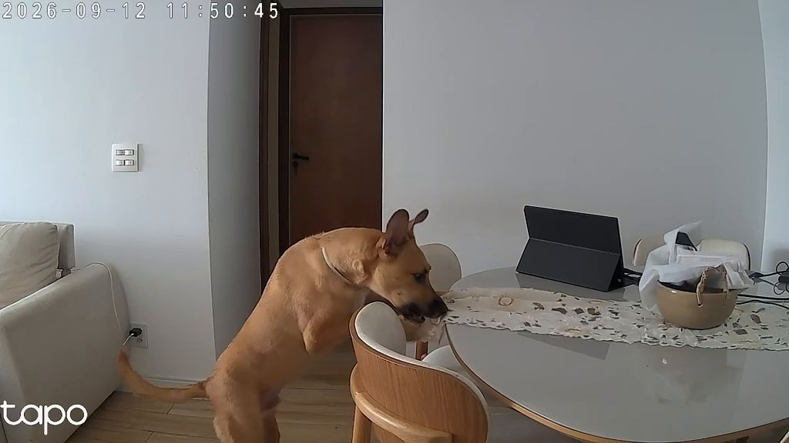
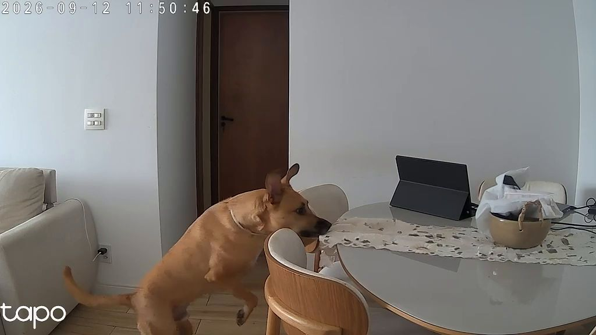
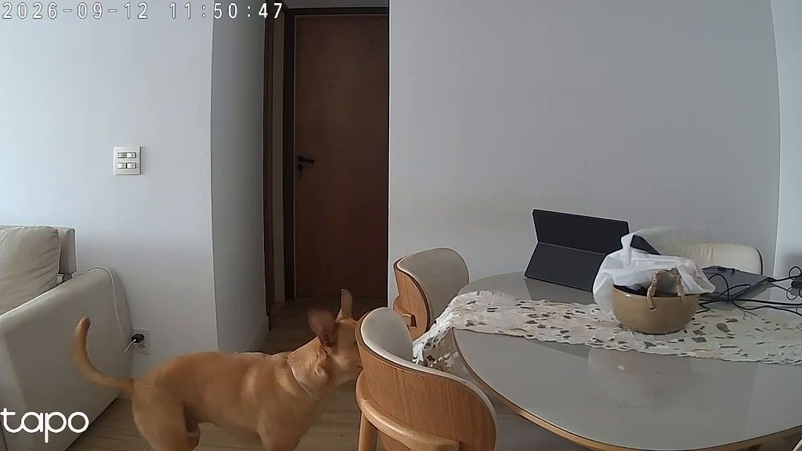
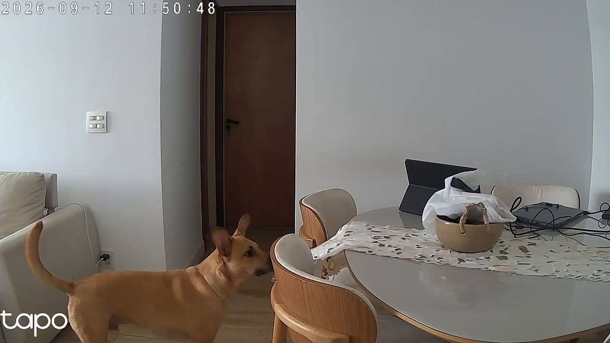
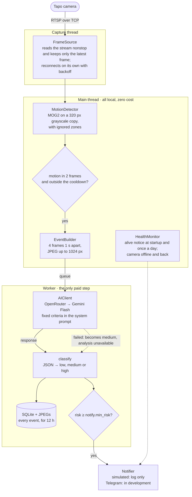

# AI_security_guard
AI-powered home surveillance

This project was 100% vibe-coded over a weekend as a fix for the problem that is Pablo, my dog. I don't plan to maintain new versions.

## Example

The local detector noticed motion in the living room, and ai_security_guard sent 6 frames, 1 s apart, to the AI:

<p>
  
  
  
  
  
  
</p>

This is the alert it produced. The classification is real: Gemini 2.5 Flash with the criteria in
[`config/risk_criteria.example.md`](config/risk_criteria.example.md), at US$ 0.00091 for the call.

*spoiler*: Pablo broke the vase

```
🔴 Risk HIGH — 2026-10-17 11:50
The dog is climbing on the table and biting an object, which is a risky situation for a pet.
A dog is seen standing on its hind legs, with its front paws on a dining table. It appears to be biting or pulling an object from the table. The dog then lowers itself and moves away from the table.
confidence 95%
```

## How it works



Four ideas hold the design together:

- **The AI is only called when something moves.** While the scene is still, it costs nothing.
  Requiring two consecutive frames filters out sensor noise, and the cooldown keeps one person
  walking across the room from turning into ten paid calls.
- **Watching doesn't stop while the AI thinks.** A call takes seconds, so it runs in a separate
  worker. The main thread keeps watching the scene.
- **A failure never turns into silence.** If the AI is down, returns garbage or the disk fills up,
  the event still produces a `medium` alert flagged "analysis unavailable". The service also reports that it's alive, at startup and once a day, and warns
  when the camera goes offline.
- **The prompt is built for caching.** The risk criteria (`config/risk_criteria.md`) always go
  first and unchanged. The time and the images come after, in the user message. That way the
  provider reuses the prefix and charges less.

## Privacy

Read this before installing: ai_security_guard handles images from inside your home.

- **What leaves your machine:** only the frames of an event (up to `event.frames_per_event`,
  downscaled to `event.max_image_width`), sent to OpenRouter and to the provider of the chosen
  model. Nothing is sent while the scene is still.
- **What stays on disk:** events (SQLite) and their JPEGs live in `data/` and are deleted after
  `storage.keep_hours` (default: 12 h). The long-term history stays on the camera itself.
- `data/`, `.env`, `config/config.yaml` and `config/risk_criteria.md` (which describes your home)
  are in `.gitignore` and are kept out of the Docker image.
- The RTSP password and the API key never show up in logs.

## Requirements

- A camera with RTSP, mounted in a fixed position. Tested with the TP-Link Tapo C200.
- Linux with Docker and the compose plugin (to run 24/7), or Python 3.12 with [uv](https://docs.astral.sh/uv/).
- An [OpenRouter](https://openrouter.ai/keys) API key. The cost of each analysis is recorded in
  SQLite.

## Installation

1. In the Tapo app: Camera → Settings → Advanced Settings → **Camera Account**. This enables RTSP.
2. Reserve a fixed IP for the camera on your router.
3. Configure:

   ```bash
   git clone https://github.com/GGGuimaraes/AI_security_guard.git && cd AI_security_guard
   cp .env.example .env                               # camera username and password, OpenRouter key
   cp config/config.example.yaml config/config.yaml   # camera IP and parameters
   cp config/risk_criteria.example.md config/risk_criteria.md       # the AI's risk criteria
   ```

4. In `config/risk_criteria.md`, rewrite the "Site context" section: what
   the camera sees, who lives in the house and what is normal there. The rest of the file works
   for most homes. Keep the file static, with no date or time, so caching keeps working.
5. Test the connection: `uv sync && uv run python scripts/smoke_camera.py`. This saves a frame to
   `data/smoke/`.

## Usage

### 24/7 with Docker

```bash
mkdir -p data                  # create it yourself so the files belong to you, not root
docker compose up -d --build   # build the image and start in the background
docker compose logs -f         # follow the logs; Ctrl+C only detaches
```

- Right after startup a "✅ ai_security_guard is running" notice goes out. With the `simulated` channel, it
  shows up in the logs, like every alert; the frames are in `data/events/YYYY-MM-DD/`.
- With `restart: unless-stopped`, the service comes back on its own after a crash or a reboot
  (as long as Docker starts at boot: `sudo systemctl enable --now docker`).
- Changed `config/`? Run `docker compose restart`. Changed the code? Run
  `docker compose up -d --build`. Changed `.env`? Run `docker compose up -d`.
- To stop: `docker compose down`.
- Networking is `host`: the container talks to the camera as if it were the host itself. Secrets
  come in through `.env` and are not baked into the image.

### Straight from the terminal

```bash
uv run python -m ai_security_guard   # Ctrl+C shuts down cleanly
```

## Configuration

Secrets live in `.env`. Everything else lives in `config/config.yaml`, which rejects unknown keys.
The parameters that matter most:

| Parameter | Default | What it controls |
|---|---|---|
| `motion.min_area_ratio` | `0.01` | fraction of the frame that must change to count as motion |
| `motion.trigger_frames` | `2` | consecutive frames with motion before calling the AI |
| `motion.ignore_zones` | `[]` | ignored rectangles `[x, y, w, h]` (0–1), e.g. the date overlay |
| `event.frames_per_event` | `4` | how many images go to the AI per event |
| `event.cooldown_seconds` | `60` | minimum interval between two analyses |
| `ai.model` | `google/gemini-2.5-flash` | any vision model on OpenRouter |
| `notify.min_risk` | `medium` | below this level the event is only recorded, with no alert |
| `storage.keep_hours` | `12` | local retention for events and their images |
| `health.daily_at` | `08:00` | time of the daily "ai_security_guard is running" notice (`null` turns it off) |

To tune the sensitivity for your scene, run
`uv run python scripts/smoke_motion.py --seconds 120` and walk in front of the camera. At the end
it prints the distribution of the changed area with the scene still and with motion, and a
suggested range for `min_area_ratio`.

## Development

```bash
uv sync
uv run pytest -q                                    # unit tests: no network, no camera, no AI
uv run ruff check --fix . && uv run ruff format .
uv run python scripts/smoke_camera.py               # real checks (need .env): smoke_camera,
                                                    # smoke_ai, smoke_motion and smoke_notify
```

The benchmark replays a recorded video of your own scene through the real modules. The reference
video is not in the repository (it shows the inside of a home): put yours at
`data/bench/reference.mp4`, or the reference tests are skipped.

```bash
uv run pytest -q -m bench                           # motion sensitivity on the video, no network
uv run pytest -q -m live                            # + real AI classification (needs .env)
```

```
src/ai_security_guard/
├── capture.py      FrameSource: RTSP in its own thread, only the latest frame
├── motion.py       MotionDetector: MOG2, ignored zones, warm-up
├── event.py        EventBuilder: batch of JPEGs with a cooldown
├── ai_client.py    AIClient: OpenRouter, retry with backoff, raw text
├── classifier.py   classify(): lenient JSON → Analysis, with a medium fallback
├── notifier.py     Alert + channels (BaseNotifier never raises)
├── storage.py      SQLite + JPEGs + retention cleanup
├── health.py       alive and camera-offline notices
├── pipeline.py     orchestrates the threads
└── config.py       YAML + .env validated with pydantic
```

## Worth pursuing

- Telegram channel status
- Bot commands (`/status`, `/pause 2h`, `/photo`)
- Multiple cameras
- Camera movement
